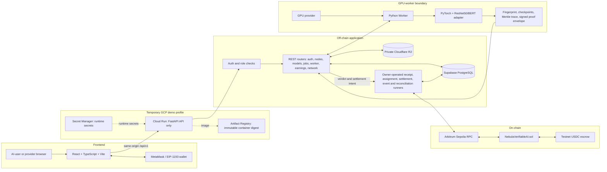
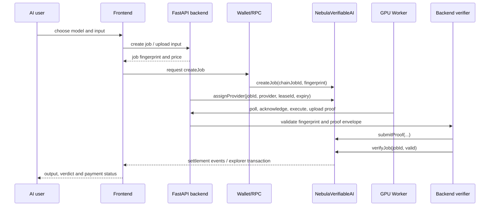
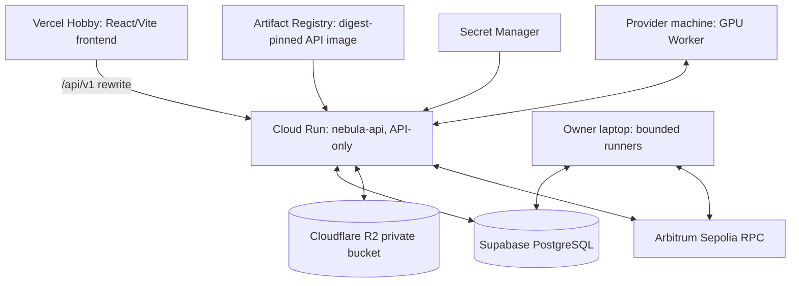

# Nebula AI Cloud — Current GCP MVP

**A blockchain-backed distributed GPU-compute marketplace for accountable AI inference.**

Nebula lets an **AI user** submit a model-inference **job**, an independently
operated **GPU provider** execute it on a registered **GPU node**, and the
system settle testnet escrow using backend-validated, worker-signed
Proof-of-AI-Execution (PoAE) evidence.

This document describes the current `Nebula-gcp` implementation and public
demonstration profile. The source code is authoritative; older OCI/Fly.io
descriptions are historical and are not this deployment.

## Problem and objectives

GPU inference is expensive to operate and difficult for a user to audit. A
provider needs dependable assignment and payment, while a user needs a clear
job lifecycle and evidence that the submitted output is bound to the requested
model and input.

Nebula combines a FastAPI orchestration layer, independently operated Python
Workers, private artifact storage, deterministic fingerprints and execution
traces, and Arbitrum Sepolia escrow. Its objectives are to:

1. Connect AI users with GPU providers.
2. Accept bounded inference jobs for approved model artifacts.
3. Assign each job to a compatible GPU node through a time-bounded lease.
4. Execute inference and produce a signed PoAE proof envelope.
5. Validate the evidence before authorizing settlement.
6. Keep payment and settlement auditable on-chain while operational state stays
   queryable off-chain.

## Current public MVP

- Frontend: <https://nebula-gcp.vercel.app>
- API origin: `https://nebula-api-93573724992.asia-south1.run.app`
- Browser API topology: Vercel same-origin `/api/v1/*` rewrite to Cloud Run.
- Chain: Arbitrum Sepolia, chain ID `421614`.
- Contract: `0xbD0A2f65ae2C67A313d2883cAed5029A3275a599`.
- Database: Supabase-hosted PostgreSQL.
- Private object storage: Cloudflare R2 through the S3-compatible API.
- Active demonstration models: pinned ResNet50 image classification and
  multilingual BERT review sentiment (1–5 stars).

Cloud Run is API-only (`RUNNERS_ENABLED=false`, minimum instances zero). The
owner-operated runner processes and GPU Workers run on controlled machines
during a demonstration. This is a supervised testnet MVP, not a mainnet
service, an availability SLA, or fully trustless inference.

## Domain vocabulary

The project uses these terms consistently:

| Term | Meaning |
|---|---|
| AI user | Wallet-identified participant who submits and funds a job. |
| Job | One approved model version executed once against one exact input. |
| GPU provider | Wallet-identified participant operating one or more GPU nodes. |
| GPU node | A provider machine registered to receive compatible leases. |
| Worker | Python process on a GPU node that executes inference and produces evidence. |
| Model artifact | Immutable, hash-identified model weights in private storage. |
| Model adapter | Versioned preprocessing, execution, output, and checkpoint rules. |
| Worker signer | Node-specific identity that signs a proof envelope. |
| Lease | Time-bounded exclusive assignment of a job to a node. |
| Job fingerprint | Deterministic binding of protocol, model, artifact, preprocessing, and input. |
| Checkpoint | Named model-specific intermediate value committed to the trace. |
| Execution trace | Ordered checkpoint names and hashes for one execution. |
| Proof envelope | Worker-signed package containing binding metadata and commitments. |
| PoAE proof | User-facing name for Nebula's simplified proof envelope protocol. |
| Verifier | Trusted backend role that validates evidence and chooses a verdict. |
| Verdict | Terminal `VALID` or `INVALID` verification decision. |
| Settlement | Terminal escrow outcome: provider credit or user refund. |

## System architecture



## Technology stack

| Layer | Technology | Purpose | Location |
|---|---|---|---|
| UI | React 18, React Router | User/provider dashboards and job forms | `frontend/` |
| UI language/build | TypeScript, Vite, Tailwind CSS | Typed browser code and production bundle | `frontend/` |
| Wallet/chain client | `viem`, EIP-1193 provider | Wallet signatures and user escrow transaction | `frontend/src/` |
| API | FastAPI, Uvicorn, Pydantic | REST API, validation, auth and health endpoints | `backend/` |
| Persistence | SQLAlchemy asyncio, asyncpg | Operational state and query projections | `backend/app/models/`, `backend/app/db/` |
| Migrations | Alembic | PostgreSQL schema evolution | `backend/alembic/` |
| Database | PostgreSQL (Supabase in deployment) | Users, jobs, leases, proofs, chain state | runtime configuration |
| Object storage | S3-compatible `boto3` client to private R2 | Inputs, results, artifacts and proof objects | `backend/app/services/storage.py`, `worker/storage/` |
| Blockchain | Solidity 0.8.20, Foundry, OpenZeppelin | Escrow, provider assignment, proof state and pull payment | `contracts/` |
| Network | Arbitrum Sepolia | Testnet settlement chain | deployment manifest/config |
| Worker | Python, PyTorch, CUDA | Model loading, preprocessing and inference | `worker/` |
| Container | Docker, Artifact Registry | Immutable API image deployment | `Dockerfile`, `deploy/gcp-demo/` |
| Hosting | Vercel and Google Cloud Run | Static frontend and API HTTPS service | deployment scripts/docs |
| Secrets | GCP Secret Manager and protected local config | Runtime credentials without Git storage | deployment wizard |

Redis, IPFS, Kubernetes, Cloud SQL, GKE, Compute Engine, and Memorystore are
not part of the current confirmed deployment.

## End-to-end flow

1. The AI user opens the React frontend and connects a wallet.
2. Wallet authentication obtains a short-lived access token; refresh is held
   in a secure HTTP-only cookie.
3. The frontend reads approved models and the public network snapshot.
4. The user submits one model input. The API validates size/type and stores the
   input privately.
5. The API creates the job, derives the input hash, model identity, price, and
   authoritative job fingerprint.
6. The wallet calls `createJob(bytes32,bytes32)` and escrows the fixed testnet
   USDC price.
7. Receipt confirmation validates the chain, contract, sender, amount, event,
   and confirmations before the job becomes schedulable.
8. The assignment runner selects a compatible node and the verifier calls
   `assignProvider(bytes32,address,bytes32,uint64)`.
9. The provider Worker polls for a lease, acknowledges it, downloads the exact
   private input/model bytes, and verifies hashes.
10. The model adapter preprocesses the input and PyTorch performs inference.
11. The Worker records model-specific checkpoints, an ordered execution trace,
    a Merkle root, output hash, and a worker-signed proof envelope.
12. The Worker uploads the result/proof and calls the worker completion routes.
13. The backend verifier checks job/lease binding, model artifact hash, input
    fingerprint, output/trace commitments, and Worker signature.
14. The verifier records `VALID` or `INVALID`; the settlement runner submits
    `verifyJob(bytes32,bool)`.
15. A valid proof credits the provider's pull-payment balance; an invalid proof
    credits the AI user. Final state is reconciled from chain events.
16. The frontend polls and displays output, verdict, proof status, job state,
    settlement, and explorer links.

If the lease expires before completion, the verifier may reassign the job. If
the deadline passes without settlement, the user can request
`requestTimeoutRefund(bytes32)`.

## Actor flows

### AI user

Connects a wallet, browses approved models, submits one bounded input, signs
the testnet escrow transaction, monitors the job, and views the output, PoAE
verdict, chain transaction, and settlement/refund.

### GPU provider

Authenticates, registers a GPU node and capabilities, receives a one-time node
credential, runs the Worker with its node identity and Worker signer, polls and
acknowledges leases, uploads results/proofs, and withdraws valid earnings.

### Backend verifier and operators

The API manages approved model metadata, validates jobs, schedules compatible
nodes, persists chain intents, confirms receipts, verifies proofs, reconciles
events, retries durable work, and authorizes the on-chain verdict. It is a
trusted role in this MVP and is separate from the provider wallet and Worker
signer.

## Low-Level Execution Flow

### Frontend

React components collect model/input data and use TypeScript types generated
from the API contract. The browser sends credentialed REST requests through
the Vercel same-origin rewrite. `viem` prepares wallet reads and transactions;
the app polls job/network projections rather than requiring WebSockets.

### Backend

FastAPI routers use Pydantic schemas and authentication dependencies. SQLAlchemy
persists users, nodes, models, jobs, payments, leases, attempts, proofs, chain
transactions, signer nonces, blockchain events, cursors, and reconciliation
incidents. Durable runner cycles create and recover receipt, assignment,
settlement, event, and reconciliation work. Web3/RPC calls happen outside
long-lived database locks; idempotency and chain-instance nonce coordination
protect retries.

### Worker

The Python Worker authenticates as a node, polls `/v1/worker/leases/next`,
acknowledges a lease, downloads hash-identified model/input objects, applies a
versioned adapter, runs PyTorch, computes checkpoint and Merkle commitments,
signs the EIP-712 proof envelope with the Worker signer, uploads the result,
and calls the completion or failure endpoint.

### Verification and settlement

The backend recomputes the expected fingerprint and checks the proof envelope,
signature, lease, model artifact, output hash, and trace commitment. The
settlement coordinator persists a transaction intent and the receipt confirmer
waits for the required confirmation policy. Event ingestion and reconciliation
repair projections after restart or delayed RPC results.

## Smart contract

### Contract and state

`NebulaVerifiableAI` stores a `Job` struct in `jobs[bytes32]`, provider/user
pending withdrawals, `totalEscrowed`, `totalPendingWithdrawals`, `verifier`,
`jobPrice`, and `maxJobAmount`. `JobState` is `None`, `Created`, `Assigned`,
`ProofSubmitted`, `Settled`, or `Refunded`.

Important lifecycle functions are:

- `createJob` — user transfers the fixed USDC price into escrow.
- `assignProvider` — verifier binds a provider and expiring lease.
- `submitProof` — verifier records the lease, Merkle root, and output hash.
- `verifyJob` — verifier settles valid provider credit or invalid user refund.
- `requestTimeoutRefund` — job creator recovers escrow after the deadline.
- `withdraw` — provider/user pulls credited funds.
- `setVerifier`, `setJobPrice`, `setMaxJobAmount`, `pause`, `unpause` — owner controls.

Events include `JobCreated`, `ProviderAssigned`, `ProofSubmitted`,
`JobSettled`, `PaymentCredited`, `TimeoutRefundCredited`,
`WithdrawalCompleted`, and role/configuration updates.

The contract uses OpenZeppelin `Ownable`, `Pausable`, `ReentrancyGuard`,
`SafeERC20`, and `SafeCast`. Pull payments follow checks-effects-interactions;
jobs settle once and solvency is tracked explicitly. On-chain state does not
contain model files, plaintext inputs, execution traces, or scheduler queues.



## Database and off-chain state

The SQLAlchemy model layer contains `User`, `SupportedModel`, `Node`, `Job`,
`Payment`, `AuthChallenge`, `AuthSession`, `Lease`, `JobAttempt`, `Proof`,
`ChainTransaction`, `SignerNonce`, `BlockchainEvent`, `ChainCursor`, and
`ReconciliationIncident`. These records connect wallet identities to nodes,
jobs to leases/attempts/proofs, and durable intents/events to their chain
projection.

The database is necessary because the chain is not a scheduler or file store.
PostgreSQL holds operational queues, private metadata, authentication state,
lease ownership, retries, and query-friendly dashboard projections. The chain
holds trust-critical escrow transitions and settlement events.

## GCP deployment architecture



Confirmed GCP services in this profile are Cloud Run, Artifact Registry, and
Secret Manager. Vercel, Supabase, R2, and Arbitrum are external services. No
GKE, Compute Engine, Cloud SQL, Memorystore, Cloud Storage, or load balancer is
required by the current deployment.

## API summary

All application routes are under `/v1` except health checks:

| Group | Routes | Purpose |
|---|---|---|
| Health | `GET /live`, `GET /ready` | Liveness and DB-backed readiness |
| Auth | `POST /auth/challenge`, `/verify`, `/refresh`, `/logout` | Wallet challenge/session lifecycle |
| Nodes | `POST /nodes`, `GET /nodes`, `GET /nodes/{id}` | Register and inspect GPU nodes |
| Node credentials | `POST /nodes/{id}/credentials/rotate`, `/revoke`; worker-signer rotation | Credential lifecycle |
| Models | `GET /models`, `GET /models/{model_id}` | Approved model catalog |
| Jobs | `POST /jobs`, `GET /jobs`, `GET /jobs/{id}`, `GET /jobs/{id}/result` | Submit and inspect jobs |
| Escrow | `POST /jobs/{id}/confirm-escrow` | Confirm user escrow receipt |
| Worker | lease next/ack/input/model/result-upload/complete/fail; node heartbeat | Worker protocol |
| Earnings | `GET /earnings` | Provider credits and withdrawal projection |
| Network | `GET /network` | Public node/network snapshot |

Exact request and response schemas are generated from the FastAPI OpenAPI
contract and checked by the frontend build.

## Reliability and failure handling

- Offline workers stop heartbeating; leases are bounded and can be reassigned.
- Failed or expired attempts are retained; the scheduler avoids duplicate live
  leases and can select another compatible node.
- Receipt confirmation and event reconciliation are restart-safe and durable.
- Proof failure produces an `INVALID` verdict and user refund rather than
  provider credit.
- Timeout after the contract deadline supports a user refund.
- Transaction intents, signer nonce state, retries, and chain cursors protect
  against delayed RPC responses and process restarts.
- Contract state is terminal and single-settlement; pull payments prevent an
  external token transfer from occurring before accounting effects.

## Security model and limitations

Implemented protections include exact-origin credentialed browser auth,
short-lived access tokens with secure refresh cookies, role checks, rate
limiting, bounded input validation, private storage, model/input SHA-256
binding, Worker EIP-712 signatures, deterministic fingerprints, contract role
checks, lease/deadline checks, replay/duplicate guards, reentrancy protection,
durable retries, and secret storage outside Git.

The guarantees must be stated precisely:

- **Blockchain guarantees:** escrow state, role-gated lifecycle transitions,
  terminal settlement, solvency accounting, and public transaction history.
- **PoAE guarantee:** tamper-evident Worker-signed evidence bound to the job,
  model artifact, input, checkpoints, and output.
- **Trust assumption:** the backend verifier is trusted to validate evidence
  and authorize the correct verdict.
- **Not provided:** zero-knowledge correctness, TEE attestation, protection
  from a provider seeing plaintext input, mainnet economics, high availability,
  or fully decentralized scheduling/verification.

## Project structure

```text
contracts/                 Solidity source, tests, deployments and artifacts
backend/app/               FastAPI routers, models, schemas, services, runners
backend/alembic/           PostgreSQL migrations
frontend/src/               React pages, wallet/auth client and API client
worker/core/               PyTorch model loaders, preprocessors and executors
worker/proof/              Fingerprint, Merkle and EIP-712 proof code
worker/storage/            R2/S3 and optional pinning adapters
deploy/gcp-demo/           Cloud Run and Vercel deployment templates
scripts/                   setup, validation, deployment and acceptance wizards
docs/                      PRD, runbooks, reports and sanitized evidence
demo-data/                 ResNet50 images and BERT review examples
```

## Local setup and verification

Supported development uses Ubuntu/WSL. Keep credentials in ignored `.env`
files or the protected wizard configuration; never commit them.

```bash
# prerequisites and local E2E tooling
./scripts/setup_e2e_wizard.sh --check
./scripts/setup_e2e_wizard.sh --install
./scripts/setup_e2e_wizard.sh --verify

# backend
cd backend
uv sync
uv run alembic upgrade head
uv run pytest -q
uv run uvicorn app.main:app --reload

# frontend
cd ../frontend
npm install
npm run lint
npm test
npm run build
npm run dev

# Worker (CUDA dependencies are selected by the Worker requirements files)
cd ../worker
uv pip install --python .venv/bin/python -r requirements.txt
.venv/bin/python -m pytest -q
```

Contract development uses Foundry:

```bash
cd contracts
forge build
forge test
forge snapshot --check
```

The GCP deployment and owner acceptance stages are intentionally interactive;
use the repository wizards rather than putting cloud credentials on the
command line. The Cloud Run service is deployed from a digest-pinned image and
the frontend build must receive the public contract address.


## Current acceptance boundary

Automated backend, frontend, contract, Worker, browser-auth, deployment, and
API checks pass. The remaining demonstration gate is live owner/friend
acceptance with a compatible provider Worker online: two funded model journeys,
proof/verdict evidence, final output, settlement or refund, and provider credit
must be captured in sanitized evidence. See
[`docs/DEMO008_COMPLETION_REPORT.md`](docs/DEMO008_COMPLETION_REPORT.md).

## Further documentation

- [Canonical MVP PRD](docs/NEBULA_PRD_v3.1.md)
- [Development plan](docs/DEVELOPMENT_PLAN.md)
- [GCP handoff](docs/NEBULA_GCP_COPY_HANDOFF.md)
- [Demo input instructions](demo-data/README.md)
- [Integration closure](docs/INTEGRATION_CLOSURE_REPORT.md)
- [Demo acceptance report](docs/DEMO008_COMPLETION_REPORT.md)

## License

MIT
